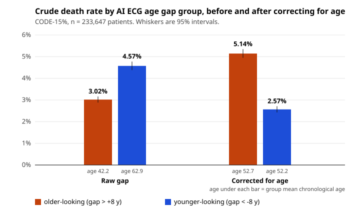

# ecg-age-gap-bias

[](https://github.com/real-adi1806/ecg-age-gap-bias/actions/workflows/verify.yml)
[](LICENSE)
[](requirements.txt)

**Age-regression bias in the AI ECG age gap: a replication on CODE-15%.**

**The AI ECG age gap is confounded by chronological age itself (r = -0.3842 on 233,647 Brazilian patients), and the confound is large enough to reverse the crude survival result.** Split this cohort the way the 2021 paper that made the biomarker famous split it, and the older-looking hearts die *less* (3.02% against 4.57%), because the raw split is really sorting people by age: mean age 42.2 in the older-looking group against 62.9 in the younger-looking one. Regress the gap on age, keep the residual, and the direction reverses to 5.14% against 2.57%. The age balance that comes with it (52.7 against 52.2) is built into the correction, so it proves nothing on its own. The direction of the mortality difference is not built in, and it holds per person-year of follow-up (14.07 against 6.83 deaths per 1,000 person-years) and with the corrected groups cut to the same sizes as the raw ones.

**This is a replication, not a discovery.** Correcting the AI-ECG predicted age for its regression on chronological age was applied by Hirota et al. on a Japanese cohort ([doi 10.1016/j.ijcha.2023.101172](https://doi.org/10.1016/j.ijcha.2023.101172), 2023) and, as a residual of the gap on age with mortality as the outcome, by Barthels et al. on a Belgian cohort ([doi 10.1093/ehjdh/ztaf137](https://doi.org/10.1093/ehjdh/ztaf137), first published 28 November 2025), who reported r = -0.54 and the same reversal. What is repeated here is the first, linear step of Barthels' correction, fitted in-sample on CODE-15%; their second step (subtracting the mean corrected gap at each integer age) and their separate validation set are not used. What is not in Barthels et al. or the 2021 paper is section 4 below.



**Not a medical device. Not for clinical use.** This is a secondary analysis of a public research dataset. It says nothing about any individual's health or risk.

---

## Quick start

```
git clone https://github.com/real-adi1806/ecg-age-gap-bias
cd ecg-age-gap-bias
python ecg_age_bias.py
```

That is the whole thing. It downloads the 35.5 MB dataset from Zenodo if it is
not already present, verifies its md5 against the published checksum, refuses to
continue if the bytes are wrong, and prints every number in this README. It
takes under 20 seconds after the download and needs **no third-party packages at
all**: no numpy, no pandas, no GPU. Every file parses under the Python 3.9
grammar and the whole suite was run end to end on **3.9.6, 3.11.17, 3.13.16
and 3.15.0**.

```
python cox_model.py      # age- and sex-adjusted Cox models, about a minute
python verify.py         # assert every number below, then check the repository
```

`verify.py` is the reason to trust this page. The figures quoted here (211 of
them) are listed inside it against the code path that produces each one, so a
README that drifts away from the code fails the check instead of quietly lying.
The rest are printed by the same code. It also fails if the Cox or Kaplan-Meier
implementation's own self-tests fail, and if the count just given goes stale.

---

## 1. The confound

| | |
|---|---|
| Patients analysed | 233,647 (one row per patient, the first exam). The 2021 paper's 218,169 is a different count, explained [below](#is-this-actually-the-cohort-the-paper-analysed) |
| Deaths | 8,341 (3.57%) |
| Median follow-up | 3.46 years |
| Mean absolute error of the age model | 8.45 years |
| **r(gap, chronological age)** | **-0.3842** |
| Fitted | gap = -0.2131 x age + 11.9755 |
| r(corrected gap, chronological age) | -0.0000, zero by construction |

The gap, conventionally called predicted age deviation or PAD, is
`ECG-predicted age minus chronological age`. A biomarker of biological ageing
that is meant to be independent of how old you are turns out to carry a large
amount of exactly that information. This is the regression bias of any age model
fitted to minimise its error: with an 8 year error, its predictions are pulled
towards the mean age, so it over-predicts for the young and under-predicts for
the old.

## 2. What it does to the crude survival split

Thresholds are the 2021 paper's own, plus or minus 8 years, chosen there because
the model's mean absolute error is about 8 years. "Died" is the crude share of
each group who died during follow-up. It ignores how long each group was
followed; the follow-up table below deals with that.

| Group | n | deaths | died | 95% CI | mean age |
|---|---|---|---|---|---|
| **Raw gap** | | | | | |
| older-looking (> +8) | 56,400 | 1,702 | 3.02% | 2.88 to 3.16 | 42.2 |
| within 8 | 134,126 | 4,667 | 3.48% | 3.38 to 3.58 | 50.4 |
| younger-looking (< -8) | 43,121 | 1,972 | 4.57% | 4.38 to 4.77 | 62.9 |
| **Bias-corrected gap** | | | | | |
| older-looking (> +8) | 47,263 | 2,431 | 5.14% | 4.95 to 5.35 | 52.7 |
| within 8 | 139,150 | 4,698 | 3.38% | 3.28 to 3.47 | 49.6 |
| younger-looking (< -8) | 47,234 | 1,212 | 2.57% | 2.43 to 2.71 | 52.2 |

Older versus younger, crude risk ratio: **0.66 raw (0.62 to 0.70), 2.00
corrected (1.87 to 2.15).**

The mean age column is the whole argument for the raw split. Before correction
the two extreme groups differ by 20.7 years of chronological age, so the
comparison is not about hearts at all.

**What is built in, and what is not.** After correction the two groups differ by
0.5 years of age, and that is not evidence of anything. The correction fits the
gap to be uncorrelated with age, by construction, so its two tails come out
close to age balanced almost automatically. (Uncorrelated is not the same as
independent, which is why both tails are still a few years older than the
middle group, at 49.6.) What the correction does not force is the direction of
the mortality difference between those balanced groups. That is what the gap
carries beyond age. It is the part of the reversal that is a result, and the
two checks below test it.

### Follow-up and censoring

The groups were not followed for the same length of time, so the share who died
can mislead. Two measures that allow for it are deaths per 1,000 person-years,
and Kaplan-Meier cumulative mortality with a 95% interval from Greenwood's
variance (on the log(-log) scale). The horizons, 2 and 4 years, come from the
follow-up distribution: 77.2% of patients are still under observation after 2
years and 40.5% after 4 (the median follow-up is 3.46 years), but only 27.2%
after 5, so a later horizon would rest on a shrinking minority.

| Group | mean follow-up, years | deaths per 1,000 person-years | Kaplan-Meier mortality at 2 years | at 4 years |
|---|---|---|---|---|
| **Raw gap** | | | | |
| older-looking (> +8) | 3.62 | 8.34 | 1.86% (1.75 to 1.98) | 3.26% (3.10 to 3.44) |
| younger-looking (< -8) | 3.73 | 12.28 | 2.73% (2.58 to 2.90) | 4.79% (4.56 to 5.02) |
| **Bias-corrected gap** | | | | |
| older-looking (> +8) | 3.65 | 14.07 | 3.13% (2.97 to 3.29) | 5.52% (5.29 to 5.76) |
| younger-looking (< -8) | 3.76 | 6.83 | 1.56% (1.44 to 1.68) | 2.71% (2.54 to 2.88) |
| **Bias-corrected gap, share-matched** | | | | |
| older-looking (> +6.620) | 3.65 | 13.92 | 3.09% (2.95 to 3.24) | 5.50% (5.28 to 5.72) |
| younger-looking (< -8.582) | 3.76 | 6.91 | 1.56% (1.44 to 1.68) | 2.73% (2.56 to 2.92) |

### Matching the group sizes

The same plus or minus 8 year cut does not take the same share of the cohort
from both gaps. On the raw gap it puts 24.14% of patients in the older-looking
group and 18.46% in the younger-looking one; on the corrected gap, 20.23% and
20.22%, because the corrected gap is centred on zero and has a narrower spread.
So the corrected comparison above is between groups of different sizes from the
raw one: a smaller older-looking group and a larger younger-looking one. To take
that difference out, the corrected gap is also cut at the raw cut's shares:
older-looking above +6.620 years and younger-looking below -8.582, which selects
exactly 56,400 and 43,121 patients, the raw groups' sizes. Those are the last
two rows of the table above (mean ages 53.1 and 52.7).

| Older-looking against younger-looking | crude risk ratio | person-year rate ratio | Cox HR, adjusted for age and sex |
|---|---|---|---|
| raw gap, > +8 against < -8 | 0.66 (0.62 to 0.70) | 0.68 (0.64 to 0.73) | 2.244 (2.095 to 2.404) |
| corrected gap, > +8 against < -8 | 2.00 (1.87 to 2.15) | 2.06 (1.92 to 2.21) | 2.056 (1.919 to 2.203) |
| corrected gap, share-matched | 1.96 (1.83 to 2.10) | 2.02 (1.88 to 2.16) | 1.961 (1.830 to 2.101) |

The crude reversal survives both checks. Allowing for follow-up moves each ratio
by a few hundredths, and matching the shares moves the corrected one from 2.00
to 1.96. The last column is the adjusted model of section 3, read as
older-looking against younger-looking directly rather than each against the
middle group. Adjusted for age, even the raw gap ranks the two groups the same
way round: the reversal is a property of the unadjusted comparison, and what the
correction buys is a crude comparison that agrees with the adjusted one.

## 3. The same thing with the published model, adjusted for age and sex

Apart from the last column of the table just above, the comparisons in section 2
are unadjusted, so they cannot be compared with the 2021 paper's headline, which
came from a Cox model adjusted for age and sex. `cox_model.py` fits that model,
in the standard library, so the comparison is like for like.

| Model | older-looking | younger-looking |
|---|---|---|
| 2021 paper, as published | HR 1.79 (1.69 to 1.90) | HR 0.78 (0.74 to 0.83) |
| **this repository, raw gap** | **HR 1.774 (1.674 to 1.880)** | **HR 0.791 (0.750 to 0.834)** |
| this repository, corrected gap | HR 1.586 (1.510 to 1.666) | HR 0.771 (0.724 to 0.822) |
| this repository, corrected gap cut at matched shares (> +6.620, < -8.582) | HR 1.538 (1.467 to 1.612) | HR 0.784 (0.734 to 0.837) |

Each hazard ratio is against the within-8 group. The published estimates fall
inside the intervals reproduced here and vice versa, which is the point: **the
published headline replicates, and the bias correction then attenuates it
rather than destroying it.**

Attenuation is quoted here on three scales, because "attenuated by X%" means
three different numbers and papers rarely say which one they mean. Raw against
corrected: the hazard ratio falls from 1.774 to 1.586, which is **10.6% on the
hazard ratio itself, 19.6% on the log hazard ratio, and 24.3% on the excess
hazard** (an excess of 77.4% becomes 58.6%). Those three figures compare groups
of different sizes (section 2). With the corrected gap cut at matched shares the
older-looking hazard ratio is 1.538, lower still, as a cut that sits closer to
zero and so takes in less extreme gaps would lead you to expect.

**A check on the code, not a result.** Fit the gap as a continuous covariate
instead of thresholding it:

| Model | hazard ratio per year of gap |
|---|---|
| raw gap, adjusted for age and sex | 1.029307 |
| corrected gap, adjusted for age and sex | 1.029307 |

These are identical, and they have to be, because it is an algebraic identity
and not a finding. The corrected gap is the raw gap minus a linear function of
age, `gap_bc = gap - (a + b x age)`, so in any model that already contains age
linearly

`beta x gap_bc + gamma x age = beta x gap + (gamma - beta x b) x age - beta x a`

The constant drops out of a Cox model, so the two fits are one model with the
age coefficient moved, and the gap coefficient cannot change. It is kept on this
page only because it tests the implementation: `cox_model.py` checks that the
two fits have the same log-likelihood and that the age coefficient moves by
exactly `-beta x b`, and `verify.py` fails if either does not hold. Barthels et
al. report the same equality, HR 1.020 per year for both in their age-adjusted
model and about 1.4% for both after adding risk factors, as the algebra requires.

What does carry information is that the hazard ratio is above 1: the gap
predicts death after adjusting for age and sex. The correction cannot change
that in a model of this form. It changes things only where the gap is used on
its own or cut into groups, because a threshold is not linear in age.
Thresholded groups are a common way to report this biomarker (the 2026
meta-analysis notes that studies "adopted different definitions"), so that is
where the confound matters most.

## 4. The part that is not in either paper

**The pooled correction is not sex fair.** Fit it on everyone, then look inside
each sex. If the correction were sex fair the mean corrected gap would be zero
in both.

| | mean corrected gap | n |
|---|---|---|
| male | **+0.372 years** | 94,736 |
| female | **-0.254 years** | 138,911 |
| residual gap | **0.626 years** | 233,647 |

Male ECGs read older. A correction fitted on the pooled cohort leaves that in
place, so every downstream threshold is applied to a quantity that is still
shifted by sex.

The slopes are nearly identical (-0.2100 in men, -0.2159 in women), so this is an
**intercept** difference, not a slope difference. The obvious fix is to correct
within sex, and this is what happens when you do:

| corrected within sex | older-looking died | younger-looking died | crude risk ratio (95% CI) |
|---|---|---|---|
| male | 6.57% | 3.48% | **1.89** (1.72 to 2.07) |
| female | 4.03% | 2.05% | **1.96** (1.77 to 2.16) |
| female against male | | | **1.04** (0.91 to 1.19) |

These are crude risk ratios: the share of the older-looking group who died
during follow-up over the same share in the younger-looking group. The last row
is the ratio of the two, with an interval from adding the variances of the two
log risk ratios, which is valid because men and women are separate groups. It
sits close to 1 with an interval that spans it, so there is no evidence that the
sexes differ. The interval is also wide enough that a modest difference in
either direction is not ruled out.

**That is a null and it is reported here as one.** The mortality gradient is
about the same in both sexes, so correcting within sex fixes the calibration of
the biomarker without changing what it predicts. A negative result about a
fairness intervention is still a result, and it is cheaper to publish it than to
let three other groups each discover it privately.

## 5. Apparently normal ECGs

The 2021 abstract makes a specific claim that the gap predicts mortality even
among ECGs read as normal. That subgroup is in the data (n = 92,138, 1,358
deaths) and the confound is **worse** there, not better: r = -0.4160.

| | older-looking died | younger-looking died | crude risk ratio (95% CI) | person-year rate ratio |
|---|---|---|---|---|
| raw gap | 1.15% | 1.94% | 0.59 (0.50 to 0.70) | 0.60 |
| corrected within this subgroup | 2.27% | 1.11% | 2.04 (1.71 to 2.43) | 2.03 |

The reversal holds in the subgroup the original abstract highlights, and
allowing for follow-up does not change it.

---

## Is this actually the cohort the paper analysed?

**233,647 is this repository's cohort and 218,169 is the paper's.** Every
analysis here uses the same 233,647 patients, or a named subgroup of them: the
345,779 exam rows in `exams.csv` minus the 112,132 rows that carry no outcome,
which leaves one row per patient (123 of the file's 233,770 patients have no row
with an outcome and drop out, and no row fails to parse). The paper reports
218,169 patients and 8,118 deaths for CODE-15%, against 233,647 and 8,341 in the
public file, and neither the paper nor the file says which step removed the
other 15,478 patients.

Worth checking rather than assuming, because the answer is yes with a caveat
that matters.

| | 2021 paper, CODE-15% | this extraction |
|---|---|---|
| r(predicted age, chronological age) | 0.84 | **0.8381** |
| mean chronological age | 51 (sd 20) | 50.74 (sd 19.82) |
| mean predicted age | 52 (sd 19) | 51.90 (sd 18.61) |
| male | 41% | 40.5% |
| mean absolute error | 8.38 (sd 7.00) | 8.45 |
| **n** | **218,169** | **233,647** |

Four summary statistics match at the paper's rounding, and the mean absolute
error is close (8.45 against 8.38). **The sample size does not match**, and this README
will not paper over it: the published analysis used 218,169 participants and
this one uses all 233,647 patients in the public deposit who carry an outcome.
The paper's methods describe an age-stratified sample from 16 to 85 years in
which only each patient's first exam is used, and the public file already looks
like that: one outcome row per patient, nobody younger than 17, and 13 patients
older than 85. So neither step accounts for the difference. Simple filters tried
while preparing this page (an age cap at 85, adults only, follow-up above zero,
no listed ECG abnormality, keeping each patient's lowest exam id) do not
reproduce both counts either. The difference is unexplained. It is a plausible
reason the reproduced hazard ratio is 1.774 and not 1.790, and it is a
limitation of this replication rather than a finding about the original.

One trap for anyone re-deriving these numbers. `exams.csv` holds 345,779 exam
rows but only 233,647 patients with an outcome, because mortality and follow-up
are recorded only on each patient's first exam. Summary statistics over all rows
give mean age 53.24 and MAE 8.53; over the analysable first-exam rows they give
50.74 and 8.45. It is the second set that matches the published table, and the
second set that this analysis uses.

---

## Novelty, stated honestly

This is the section that decides whether the rest of the page is trustworthy, so
it names the instrument and the gaps rather than asserting a first.

**What was searched**, all on the Europe PMC REST API on 22 September 2026, and
all retrieved rather than recalled:

- The record and full text of the 2021 paper (PMC8387361), the Belgian
  correction paper (PMC12853119), a second bias paper in the same journal
  (PMC12994139), and the 2026 meta-analysis (PMC13398890). The Japanese paper
  (PMC9841236) was read afterwards, once the Belgian paper's discussion had
  pointed to it. Every word frequency
  quoted here was counted in that retrieved full text.
- The complete citation list of the 2021 paper: **172 citing records**, all
  retrieved. Their titles were pattern matched for bias, confounding,
  calibration, residual, correction, fairness, subgroup and sex vocabulary.
  **Five matched. Zero mention CODE-15.** Of the five, one is the correction
  paper being replicated here; three are about predicting *sex* from an ECG,
  which is a different task; and one is a 2024 narrative review of data bias in
  cardiology AI in general, which does not address the age-gap regression bias
  or the sex fairness of a correction for it.

**A caveat on that instrument, worth stating because it cost time.** Europe PMC
returns a bare version stamp, `{"version":"6.9"}`, with no hitCount and no error,
when a query trips it. **That is not a zero result**, and reading it as one is
how a literature search silently returns nothing. A query form that failed was
re-run successfully with `SRC:MED AND EXT_ID:` prefixing. The citations endpoint
returned HTTP 500 for `pageSize=1000` on 22 September and worked at 200; a later
check returned 200 at 1000 as well, so that failure may not recur.

**What was NOT reached, stated as plainly as what was.** Scopus, Web of Science,
Google Scholar and IEEE Xplore were not searched, and neither were preprint
servers. Across the 172 citing records only TITLES were matched, not abstracts
and not full texts, so a paper doing this correction without saying so in its
title would not have been found. That is what happened: this title screen missed
Hirota et al. 2023, which corrects for the bias without saying so in its title.
It was found through the discussion section of Barthels et al.

Europe PMC's citation graph is not the same as
Scopus's or Web of Science's and will be incomplete.

**Therefore.** The claim made here is the narrow one that can be supported:
*the published corrections were applied to Japanese and Belgian cohorts, not to
CODE-15%, and nothing found suggests a CODE-15% replication exists.*
That is a hypothesis consistent with what was searched. It is not an established
fact, and anyone submitting this should check Scopus first.

**One piece of timing that is checkable in a minute and is the most interesting
thing here.** The 2026 meta-analysis of this biomarker
([doi 10.36660/abc.20250650](https://doi.org/10.36660/abc.20250650)) pooled seven
studies (eleven analyses) of the *uncorrected* gap for all-cause mortality, from
a review of ten studies (over 550,000 participants, 336,026 after removing
overlapping datasets), and reported a pooled hazard ratio of 1.83 with
I-squared of 82.9%, which is substantial unexplained heterogeneity. It searched nine databases
including Scopus and Web of Science from inception to **1 May 2025**. The
correction paper was first published on **28 November 2025**, nearly seven months after
that search closed. In the meta-analysis full text, "regression bias", "confound",
"bias-correct" and "residual" each appear **zero** times.

Whether the confound explains any of that heterogeneity is an open question and
this repository does not answer it. Seven studies is barely enough for one
covariate in a meta-regression, and it may well return nothing.

**A correction to a tempting framing.** This is not a novel statistical idea in
any field. Regressing an age gap on chronological age is long standing practice
in the neuroimaging "brain age" literature, and any predicted-age-minus-real-age
biomarker in any organ carries the same bias. The contribution here is a cohort
and a subgroup result, not a method.

---

## What this does and does not show

**It does not show the 2021 paper is wrong.** That paper adjusted for age and
sex and its headline replicates here (section 3). The crude reversal in section
2 is a statement about the raw gap as a standalone quantity, which is how it is
frequently used downstream, and not about the published model.

**It does not show the biomarker is useless.** In a continuous model adjusted
for age and sex the gap still predicts death, HR 1.0293 per year (section 3).
That the corrected gap returns the same number is algebra, not a second piece of
evidence.

**It does show** that the raw gap is heavily age-confounded, that this reverses
the direction of a crude, unadjusted comparison of thresholded groups, that the
age adjustment in the published model is therefore carrying a great deal of
weight, and that the standard pooled correction leaves a 0.63 year sex offset
behind. Part of the reversal is built in, because the corrected groups are age
balanced by construction. The direction of the corrected mortality difference is
not built in, and it holds per person-year, by Kaplan-Meier and at matched group
sizes (section 2).

**Design limits.** This is a secondary analysis of a single observational
cohort. No new model was trained: the age predictions are the original authors'
own, already a column in the published file, so nothing here says anything about
any other ECG age model. The crude percentages ignore censoring. The person-year
rates and Kaplan-Meier estimates in section 2 and the Cox models in section 3 do
not, and should be preferred. Deaths are from record linkage and cause of
death is not available. There is no external validation set in this repository.

## Using the correction on another cohort

The scripts are locked to the published `exams.csv` on purpose: they check its
md5 and refuse any other file, so the numbers on this page cannot come from a
different file by accident. The correction itself needs nothing from here. With
chronological age and predicted age for each person in your own cohort:

1. Compute the gap: predicted age minus chronological age.
2. Fit it on chronological age by ordinary least squares: `gap = a + b x age`.
3. Use the residual, `gap - (a + b x age)`, in place of the raw gap.

On CODE-15% the fit is a = 11.9755 and b = -0.2131 (section 1). Fit a and b on
your own cohort rather than reusing these. Then check what section 4 checks: a
fit on everyone can leave the corrected gap offset between men and women.

## Does the correction transfer to another country?

[`germany/`](germany/) tests exactly that advice. It runs the same published
network on the German PTB-XL cohort and applies the line fitted here without
refitting, then measures what the line leaves behind: level, shape by age band
and the offset between men and women. PTB-XL has no outcomes, so it is about the
bias of the gap only. Unlike this folder it needs the raw waveforms (about 49 GB),
torch and a few other packages; `germany/README.md` has the one command, and its
committed results can be checked without any data by `python germany/verify_germany.py`.

---

## Data

CODE-15%, from the Telehealth Network of Minas Gerais, Brazil.

> Ribeiro, A. H., Paixao, G. M. M., Lima, E. M., Horta Ribeiro, M. et al. *CODE-15%: a large
> scale annotated dataset of 12-lead ECGs.* Zenodo.
> https://doi.org/10.5281/zenodo.4916206 Licensed CC BY 4.0.

This repository contains no patient data and its MIT licence does not cover the
data. CC BY 4.0 permits reuse, including commercial reuse, with attribution; the
citation above is that attribution. Anyone running this code downloads the data
from Zenodo directly and is bound by the data's licence, not by this one.

Only `exams.csv` is used: 35,500,900 bytes, md5
`0107516d3f63864498fb77d15799cc95`. The 46 GB of raw waveforms in the same
deposit is not needed, because the neural network's own age predictions are
already a column.

**No data file is committed to this repository, and the `.gitignore` is written
so that it cannot be by accident.** A pre-commit hook that refuses data files
and anything over 1 MB ships in `.githooks/`; switch it on once per clone with
`git config core.hooksPath .githooks`.

## Files

| | |
|---|---|
| `ecg_age_bias.py` | the replication. Standard library only. Downloads, checksums, analyses (crude shares, person-year rates, Kaplan-Meier), writes `results/results.json` |
| `cox_model.py` | Cox proportional hazards with Efron ties, also standard library. `--selftest` runs the correctness checks alone |
| `verify.py` | asserts every number in this README, then scans the repository for secrets, absolute paths, data files and em dashes |
| `make_figure.py` | draws `figure.svg` at the top of this page from `results/results.json`. Standard library only, reads numbers and computes nothing new |
| `crosscheck_lifelines.py` | optional. Re-fits the same models with lifelines and compares. The only reason `requirements.txt` is not empty |
| `Makefile` | optional convenience. Every target is one python command |
| `germany/` | the transportability test on PTB-XL, with its own README, dependencies and committed results |

## Is the Cox implementation right?

It is written out rather than imported, so the question is fair. It is checked
four ways, and all four are reproducible from this repository.

1. **Against a naive implementation.** The fast cumulative-sum risk-set
   accumulation is compared with a transparent O(n squared) loop over the whole
   risk set at every event time. Worst relative disagreement across
   log-likelihood, gradient and information matrix: **2.41e-15** on Python
   3.15, which is machine precision (exactly 0 on 3.11; the docstring of
   `selftest_fast_vs_naive` in `cox_model.py` explains why newer Pythons
   differ).
   `python cox_model.py --selftest`
2. **Against the optimality conditions.** At the solution, max absolute score is
   **4.1e-09** and the information matrix is positive definite.
3. **Against lifelines.** Standard errors agree to **6.0e-09**. Standard errors
   are the sharp test because they come from the information matrix, a second
   derivative, which is unforgiving of any error in the likelihood. The fitted
   log-likelihood here is never lower than lifelines' own.
4. **Against a published number this code did not produce.** HR 1.774 against
   the paper's 1.79, on nearly the same cohort.

`python verify.py` runs 211 numeric assertions and 6 self-tests plus the hygiene
scan and exits non-zero if any of them moves. The self-tests include the
Kaplan-Meier estimates against a slow transcription of the definition, and the
older-against-younger contrasts against a refit with a different reference
group. This version was run to completion on Python 3.9.6, 3.11.17, 3.13.16 and
3.15.0 against the md5-verified local copy of the data; an earlier version was
also run on a fresh clone that downloaded the data itself.

On point 3, one detail is worth recording because the obvious version of that
check failed first. Comparing *coefficients* at 1e-6 fails, and the reason is
not arithmetic: evaluating both solutions in the same likelihood gives max score
4.1e-09 here against 2.1e-01 for lifelines, and a log-likelihood of
-94661.982283812 against -94661.982283830. lifelines stops slightly earlier, so
a coefficient tolerance measures its stopping rule rather than this code's
correctness. Both answers are right to every decimal anyone reports.

---

## Declarations

**Author.** Adithya Krishnan.

**Affiliation.** None at the time of this analysis. The author began an MBBS at
Barts and The London School of Medicine and Dentistry, Queen Mary University of
London, in September 2026. No institution has reviewed, sponsored or endorsed
this work.

**Funding.** None.

**Competing interests.** None.

**Ethics.** No new approval was sought and none is required. This is a secondary
analysis of a published, de-identified, openly licensed dataset containing no
identifiers. The original CODE study was approved by the Research Ethics
Committee of the Universidade Federal de Minas Gerais under protocol
49368496317.7.0000.5149, and that committee did not require informed consent for
secondary analysis of the anonymised database. Nothing here re-identifies anyone
or adds a participant.

**Contributions.** All analysis, code and text by the author. Large language
model assistance was used during drafting and coding. Every number computed
from CODE-15% is produced by the code in it and can be regenerated with one
command; numbers quoted from other papers were copied from their full texts and
are cited.

**Data availability.** The dataset is public at the DOI above and is not
redistributed here. Every result regenerates from it with `python verify.py`.

---

## References

1. Lima, E. M., Ribeiro, A. H., Paixao, G. M. M. et al. Deep neural
   network-estimated electrocardiographic age as a mortality predictor.
   *Nature Communications* **12**, 5117 (2021).
   [doi 10.1038/s41467-021-25351-7](https://doi.org/10.1038/s41467-021-25351-7).
   PMID 34433816, PMC8387361. Open access.
2. Barthels, M., Verhofstadt, E., Delgado, I. B. et al. Artificial
   intelligence-predicted ECG age gap as a biomarker: bias-adjusted correlation
   with mortality and cardiovascular risk factors. *European Heart Journal
   Digital Health* **7**(2) (2026), first published 28 November 2025.
   [doi 10.1093/ehjdh/ztaf137](https://doi.org/10.1093/ehjdh/ztaf137).
   PMID 41624565, PMC12853119. Open access. **The method repeated here.**
3. Vander Heyde, L., Dujardin, K., Anné, W. et al. Artificial
   intelligence-derived electrocardiographic age gap as a predictor of mortality
   after coronary revascularization: prognostic value and short-term
   intra-patient variability. *European Heart Journal Digital Health* **7**(3)
   (2026).
   [doi 10.1093/ehjdh/ztag039](https://doi.org/10.1093/ehjdh/ztag039).
   PMID 41853636, PMC12994139. Open access.
4. Bozzi, I. C. R. S., Lima, M. C. A. G., Ribeiro, A. L. P., Paixão, G. M. M.
   Artificial Intelligence-Derived ECG-Age as a Predictor of Mortality and
   Cardiovascular Events: A Systematic Review and Meta-Analysis. *Arquivos
   Brasileiros de Cardiologia* **123**(4) (2026).
   [doi 10.36660/abc.20250650](https://doi.org/10.36660/abc.20250650).
   PMID 42307380, PMC13398890. Open access. PROSPERO CRD420251042467.
5. Hirota, N., Suzuki, S., Motogi, J. et al. Cardiovascular events and
   artificial intelligence-predicted age using 12-lead electrocardiograms.
   *International Journal of Cardiology. Heart & Vasculature* **44**, 101172
   (2023). [doi 10.1016/j.ijcha.2023.101172](https://doi.org/10.1016/j.ijcha.2023.101172).
   PMID 36654885, PMC9841236. Open access. Applied a linear bias correction to
   the predicted age on a Japanese single-centre cohort.

## Citing it

GitHub's "Cite this repository" button (from `CITATION.cff`) gives the citation.
Please cite the dataset and the papers this replicates as well; they are listed
in the same file and under References above.

## Contributing

Bug reports and questions are welcome as issues. If a number here does not
reproduce on your machine, an issue with the output of `python verify.py` and
your Python version is the most useful thing to send.

## Licence

Code: MIT, see `LICENSE`. Data: CC BY 4.0, held by its original authors and not
redistributed here.
