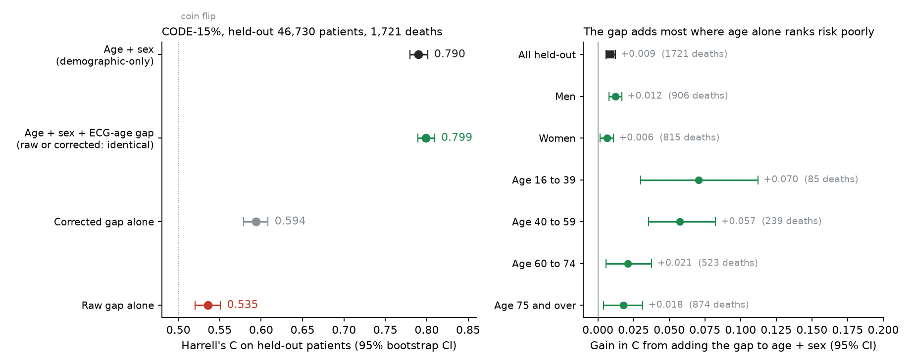

# Does the ECG-age gap add anything to age and sex?

The parent folder replicates the age-bias correction of the AI ECG age gap on the Brazilian CODE-15% cohort. This folder asks what a prediction researcher would ask next: **once age and sex are already in the model, does the gap still help predict death?** It uses the same cohort and the same correction, imported from the parent's `ecg_age_bias.py`.

**Not a medical device. Not for clinical use.**

Lukyanenko et al. (BioData Mining, 2025) benchmarked death prediction from ECGs and reported that a model using only demographics reaches a concordance of 0.79 on the CODE-15% test set. This repository asks the question that result raises for the ECG-age gap (the age a neural network reads from an ECG, minus the patient's real age): once age and sex are in the model, how much does the gap add?

Short answer: a little overall, more within age bands, and the age correction of the gap makes no difference once age is in the model.

## Results

Held-out 20% of patients: 46,730 patients, 1,721 deaths. Cox models fitted on the other 80%. Harrell's C with 95% bootstrap intervals (1,000 resamples of patients).

| Model | Held-out C (95% CI) |
|---|---|
| Age + sex | 0.790 (0.780 to 0.801) |
| Age + sex + ECG-age gap | 0.799 (0.789 to 0.809) |
| Corrected gap alone | 0.594 (0.579 to 0.608) |
| Raw gap alone | 0.535 (0.520 to 0.551) |

- Adding the gap to age and sex: +0.009 (95% CI 0.006 to 0.012).
- Within age bands the gain is larger: +0.070 (0.030 to 0.112) at ages 16 to 39, from 85 deaths, and +0.057 (0.036 to 0.082) at ages 40 to 59, from 239 deaths.
- Used alone, the raw gap's hazard ratio per year is 0.986, below 1, because the raw gap falls with age. The residual correction of Barthels et al. turns it to 1.024.

The full table, subgroups, cross-validation and checks are in [`results/SUMMARY.md`](results/SUMMARY.md). The figure is [`results/cindex.png`](results/cindex.png).



## What is true by construction, and is not a finding

The corrected gap is the raw gap minus a straight line in age. In any model that already contains age, the raw gap and the corrected gap give the same fitted risk scores, so the same concordance and the same hazard ratio for the gap (1.029 per year for both here). The correction can only matter when the gap is used without age.

## Limits

- The split is this repository's own 80/20 split by patient (fixed seed). The published benchmark's split cannot be rebuilt from `exams.csv`, so 0.790 here and 0.79 there are the same kind of model on the same cohort, not the same test set.
- The gain in young adults rests on 85 deaths.
- Harrell's C over the whole follow-up (median 3.46 years), not at a fixed horizon. No calibration or decision analysis.
- One cohort, in Brazil.
- CODE-15% was held out from the training of the network that produced the ECG ages (Lima et al., 2021), so the predicted ages are out of sample.

## Reproduce

Needs the dataset the parent folder already uses: `exams.csv` from CODE-15% (Zenodo record 4916206) in `../data/`. Only this one file is needed; the ECG traces are not. Running `python ecg_age_bias.py` in the parent downloads it, checksum-checked.

```
cd gap-over-age-sex
python -m pip install -r requirements.txt
python analysis.py --boot 1000     # writes results/results.json, about 10 minutes
python make_summary.py             # writes results/SUMMARY.md from results.json
python make_figure.py              # writes results/cindex.png
```

If `exams.csv` is elsewhere: `python analysis.py --data /path/to/exams.csv`.

The seed is fixed (20261108), so the point estimates should match `results/results.json` exactly. Every number in `SUMMARY.md` is written by `make_summary.py` from `results.json`; none is typed by hand. The results are committed here because they take about ten minutes to regenerate; the dataset is not.

Unlike the parent folder's standard-library-only analysis, this one needs lifelines, pandas, numpy and matplotlib (`requirements.txt`).

## Data

CODE-15%: Ribeiro, A. H., Paixao, G. M. M., Lima, E. M., Horta Ribeiro, M. et al. *CODE-15%: a large scale annotated dataset of 12-lead ECGs*. Zenodo, version 1.0.0, published 9 June 2021. https://doi.org/10.5281/zenodo.4916206. Licence shown on the record: Creative Commons Attribution 4.0 International (record loaded 11 November 2026).

No data are stored in this repository.

## References

1. Lukyanenko, P., Mayourian, J., Liu, M., Triedman, J. K., Ghelani, S. J., La Cava, W. G. Deep survival analysis from adult and pediatric electrocardiograms: a multi-center benchmark study. *BioData Mining* (2025). https://doi.org/10.1186/s13040-025-00510-4
2. Lima, E. M., Ribeiro, A. H., Paixao, G. M. M. et al. Deep neural network-estimated electrocardiographic age as a mortality predictor. *Nature Communications* 12, 5117 (2021). https://doi.org/10.1038/s41467-021-25351-7
3. Barthels, M., Verhofstadt, E., Delgado, I. B. et al. Artificial intelligence-predicted ECG age gap as a biomarker: bias-adjusted correlation with mortality and cardiovascular risk factors. *European Heart Journal Digital Health* 7(2) (2026), first published 28 November 2025. https://doi.org/10.1093/ehjdh/ztaf137

## Author and licence

Adithya Krishnan, independent researcher.

Licence: same as the repository (see `../LICENSE`).
