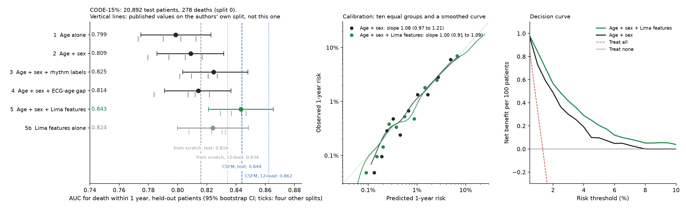

# What sits under a foundation model's 1-year mortality AUC on CODE-15%?

The parent folder replicates the age-bias correction of the AI ECG age gap on the Brazilian CODE-15% cohort, and `../gap-over-age-sex` asks what the gap adds to age and sex. This folder asks the same kind of question about a newer result.

Gu et al. (Nature Machine Intelligence, 2026) pretrained a cardiac foundation model, CSFM, and report its AUC for death within one year of the ECG on CODE-15%, against neural networks trained from scratch. The comparison is between networks. This folder adds the rows underneath: age alone, age and sex, the rhythm labels that ship with the dataset, the ECG-age gap, and a linear model on the frozen features of the 2021 ECG-age network of Lima et al.

**Not a medical device. Not for clinical use.**

**The splits here are not the authors' split, which is not published. No row below can be said to beat or match CSFM; the published numbers are shown beside ours, not against them.**

## Results

Held-out patients of split 0 whose outcome exam has saved network features: 20,892 patients, 278 deaths. AUC for death within one year, with 95% bootstrap intervals (1,000 resamples of patients), and the mean and range over five different splits.

| Row | Inputs | Test AUC, split 0 (95% CI) | Mean of 5 splits (range) | Difference from row 2 (95% CI) |
|---|---|---|---|---|
| 1 | Age alone, as a rank | 0.799 (0.775 to 0.823) | 0.795 (0.773 to 0.813) | -0.010 (-0.016 to -0.004) |
| 2 | Age + sex | 0.809 (0.786 to 0.832) | 0.801 (0.780 to 0.817) | reference |
| 3 | Age + sex + six rhythm labels + normal_ecg | 0.825 (0.803 to 0.848) | 0.817 (0.802 to 0.827) | +0.016 (0.006 to 0.026) |
| 4 | Age + sex + ECG-age gap | 0.814 (0.791 to 0.837) | 0.808 (0.784 to 0.822) | +0.005 (-0.003 to 0.013) |
| 5 | Age + sex + frozen Lima network features (ridge) | 0.843 (0.821 to 0.865) | 0.840 (0.829 to 0.847) | +0.034 (0.017 to 0.052) |
| 5b | Frozen Lima network features alone (ridge) | 0.824 (0.800 to 0.848) | 0.824 (0.808 to 0.833) | +0.015 (-0.007 to 0.037) |

Published by Gu et al. on their own test split, for reference only:

| Source | From scratch | CSFM |
|---|---|---|
| Results text, lead setting not stated | 0.816 | up to 0.844 |
| Source Data for Fig. 3a, 12 leads, best mean of 3 seeds | 0.834 | 0.862 |
| Source Data for Fig. 3a, 6 leads, best mean of 3 seeds | 0.815 | 0.841 |

- Age and sex alone reach 0.809 on split 0. The rhythm labels add +0.016; the ECG-age gap adds +0.005, with an interval that includes zero.
- A linear model on the 2021 network's frozen features, with age and sex, reaches 0.843 on split 0 and between 0.829 and 0.847 across the five splits. The Lima network reads 12 leads, so the 12-lead published values are the like-for-like ones, and they were measured on a different split.
- That model is well calibrated on the held-out patients: slope 1.00 (95% CI 0.91 to 1.09), intercept in the large +0.01.
- On a decision curve it has higher net benefit than age and sex at thresholds from 1% to 5%; the gain is small in absolute terms because death within a year is rare (about 1.25%).
- Treating the 8,778 patients with under a year of follow-up as survivors instead of leaving them out moves every row by 0.002 or less.

The full tables, calibration, decision curve, subgroups, sensitivity analysis and checks are in [`results/SUMMARY.md`](results/SUMMARY.md). The figure is [`results/ladder.png`](results/ladder.png).



## What is true by construction, and is not a finding

Row 4 uses the ECG-age gap (predicted age minus age). With age already in the model, the gap and the predicted age carry the same information, so "age + sex + gap" and "age + sex + predicted age" give the same AUC. The run checks this and it holds exactly.

## How the cohort and label were built

- `exams.csv` has 233,647 patients with a death flag and a follow-up time, the same count as the paper's supplement gives for CODE-15.
- Label: died within one year of the exam. 2,812 patients.
- 8,778 patients were alive at last contact with under one year of follow-up, so their one-year outcome is unknown. The main analysis leaves them out (death rate 1.25%). Sensitivity A keeps them as survivors (1.20%). The paper reports 1.23%; how it treated these patients is not stated in what we could read.
- Five patient-level 80/10/10 splits, stratified on the label. Models are fitted on train, the ridge penalty is chosen on validation, and the test patients are scored once.

## A limit you should know about: the saved features

Row 5 uses features saved earlier by `ecg-age-model/extract_code.py`, one exam per patient (the lowest exam id). For 15,715 of the 233,647 patients that exam is not the one the outcome is attached to, and in 94% of those cases it is a later exam (the patient is older). Using it would leak the future, so row 5 is fitted and scored only on the 217,932 patients whose saved features belong to the outcome exam. Rows 1 to 4 are reported on those same test patients (Table A in the summary) and on all test patients (Table B). The left-out patients all have two or more exams and a much lower death rate, so the subset is not a random sample.

## Other limits

- Row 5 is a linear model on a frozen network's last layer. It shows what that network already encodes; it is not a fine-tuned network.
- The Lima network reads all 12 leads. The paper's headline values in the text (0.844 and 0.816) do not appear in its Fig. 3a source data, where the 12-lead values are higher and the six-lead values are close to the text. Which lead setting the text refers to is our inference, not a stated fact.
- CODE-15% was held out from the training of the Lima network, so its features are out of sample here.
- One cohort, in Brazil. About 280 deaths in each test split.

## Reproduce

Needs `exams.csv` from CODE-15% (Zenodo record 4916206) in `../data/`, and the saved network features (`code_part{0..17}_feat.npy` and `_ids.npy`, about 5 GB, produced by `extract_code.py` in the companion `ecg-age-model` folder from the CODE-15% traces). Peak memory is about 10 GB.

```
cd one-year-mortality-baselines
python -m pip install -r requirements.txt
python tests/test_ladder.py        # 12 tests, a few seconds; also runs under pytest
python analysis.py --boot 1000     # writes results/results.json, about 9 minutes on an Apple M5
python make_summary.py             # writes results/SUMMARY.md from results.json
python make_figure.py              # writes results/ladder.png
```

If the files are elsewhere: `python analysis.py --data /path/to/exams.csv --features /path/to/features`.

The seeds are fixed, so the point estimates should match `results/results.json`. Every number in `SUMMARY.md` is written by `make_summary.py`; none is typed by hand. `make_summary.py` and `make_figure.py` refuse to run if any check in `results.json` failed. The decision curve reuses `../decision-curves/netbenefit.py`.

## Files

| File | What it is |
|---|---|
| `analysis.py` | The whole analysis |
| `ladder.py` | Cohort, splits, AUC by hand, Newton logistic regression, calibration, bootstrap, feature loading |
| `tests/test_ladder.py` | Hand-worked tests of `ladder.py` |
| `make_summary.py`, `make_figure.py` | Build `results/SUMMARY.md` and `results/ladder.png` from `results/results.json` |
| `results/published_fig3a.json` | The published AUCs for this task, read from the paper's Source Data for Fig. 3a |
| `results/run_output.txt` | The console output of the reported run |

## Data

CODE-15%: Ribeiro, A. H., Paixao, G. M. M., Lima, E. M., Horta Ribeiro, M. et al. *CODE-15%: a large scale annotated dataset of 12-lead ECGs*. Zenodo, version 1.0.0. https://doi.org/10.5281/zenodo.4916206. Creative Commons Attribution 4.0 International.

No patient data are stored in this repository.

## References

1. Gu, X., Tang, W., Han, J. et al. Cardiac health assessment across scenarios and devices using a multimodal foundation model pretrained on data from 1.7 million individuals. *Nature Machine Intelligence* 8(2), 220-233 (2026). https://doi.org/10.1038/s42256-026-01180-5
2. Lima, E. M., Ribeiro, A. H., Paixao, G. M. M. et al. Deep neural network-estimated electrocardiographic age as a mortality predictor. *Nature Communications* 12, 5117 (2021). https://doi.org/10.1038/s41467-021-25351-7
3. Vickers, A. J., Elkin, E. B. Decision curve analysis: a novel method for evaluating prediction models. *Medical Decision Making* 26(6), 565-574 (2006). https://doi.org/10.1177/0272989X06295361

## Author and licence

Adithya Krishnan, independent researcher.

Licence: same as the repository (see `../LICENSE`).
